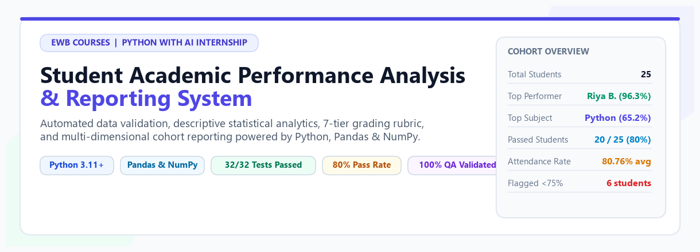
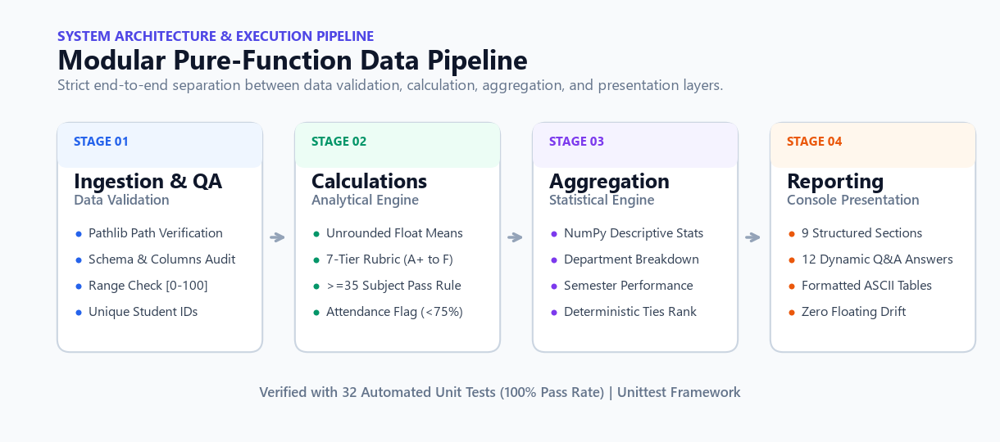
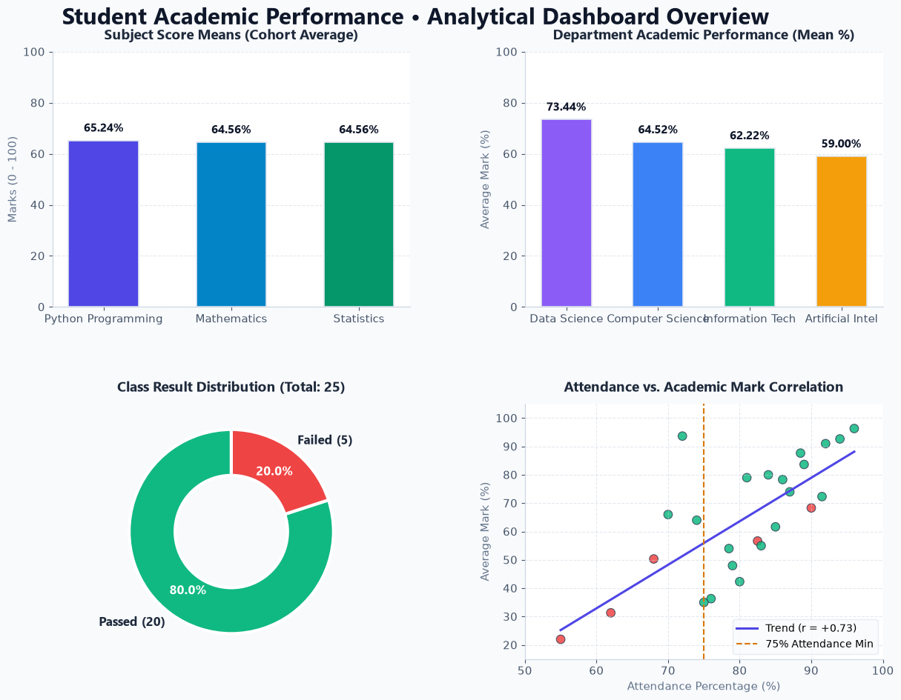
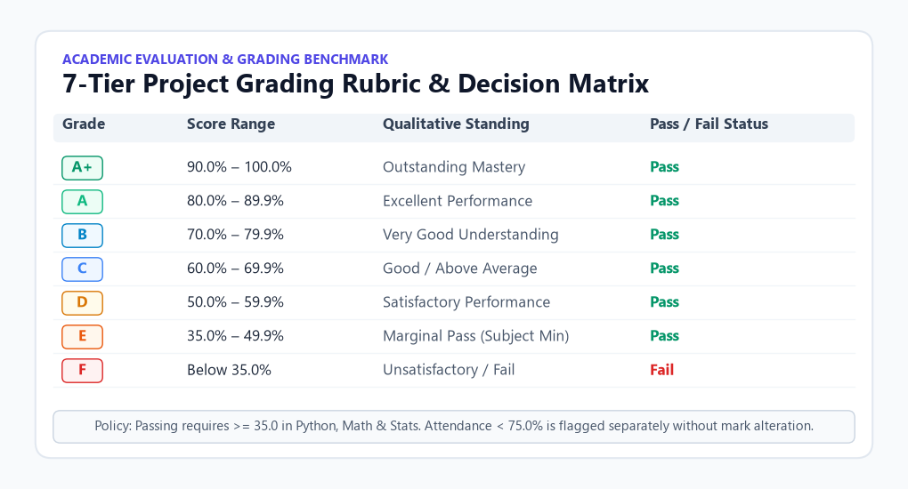
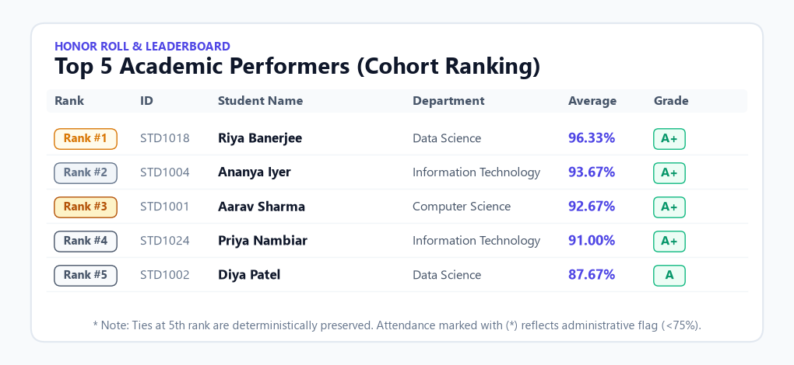
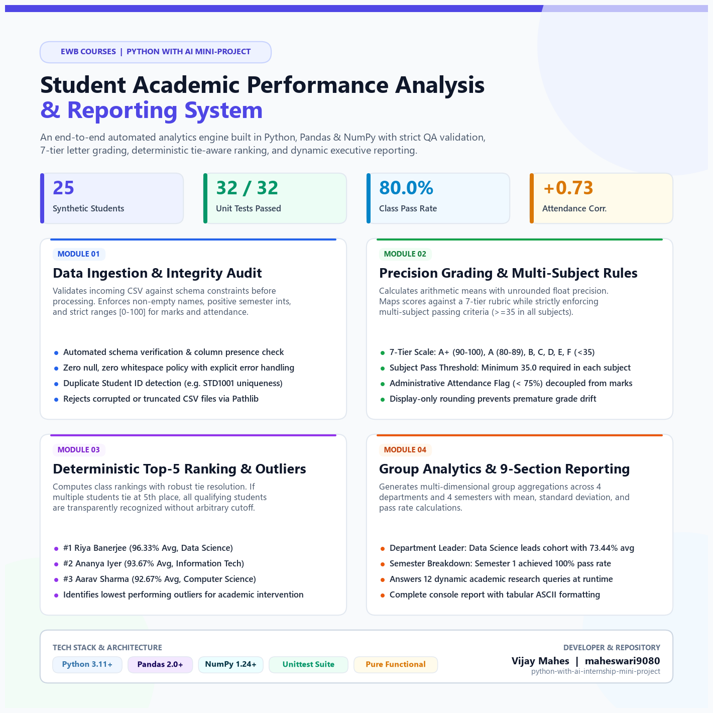

# Student Academic Performance Analysis and Reporting System

<p align="center">
  
</p>

<p align="center">
  <a href="https://www.python.org/downloads/"></a>
  <a href="https://pandas.pydata.org/"></a>
  <a href="https://numpy.org/"></a>
  <a href="tests/"></a>
  <a href="LICENSE"></a>
  <a href="#author--credits"></a>
</p>

---

## 📌 Executive Summary

The **Student Academic Performance Analysis and Reporting System** is an end-to-end command-line analytical platform developed for academic institutions. Engineered strictly with Python, Pandas, and NumPy, it automates the ingestion, data quality auditing, statistical evaluation, 7-tier letter grading, cohort ranking, and multi-dimensional reporting of student academic performance.

> **Course**: EWB Courses | Python with AI Internship Mini-Project  
> **Key Benchmark**: 25 Synthetic Student Records | 32 Automated Unit Tests (100% Pass Rate) | Strict Pure-Function Design

---

## 🌟 Key Highlights & Metrics

| 🎓 Cohort Size | 🏆 Top Score | 📊 Pass Rate | ⚡ Attendance Correlation | 🛡️ Test Suite |
| :---: | :---: | :---: | :---: | :---: |
| **25 Students** | **96.33%** (Riya Banerjee) | **80.00%** (20 Passed) | **+0.73** (Positive Trend) | **32 / 32 Passed** |

- **Strict Pre-Flight Validation**: Zero-null policy, non-empty text, positive semester integers, and $[0.0, 100.0]$ range enforcement.
- **Precision Academic Logic**: Continuous unrounded floating-point averages with presentation-only rounding.
- **7-Tier Letter Rubric**: $A^+$ through $F$ mapped cleanly to standard institutional evaluation tiers.
- **Multi-Subject Pass Rule**: Students must score $\ge 35.0$ in **all three subjects** (Python, Mathematics, Statistics) to achieve an overall Pass.
- **Decoupled Attendance Auditing**: Attendance $< 75.0\%$ is tracked as an administrative deficiency without distorting academic subject marks.
- **Deterministic Tie-Aware Ranking**: Top-5 rankings transparently preserve all students tied at the 5th position.
- **Dynamic 9-Section Reporting**: Answers 12 core academic queries at runtime with clean ASCII formatting.

---

## 🏗️ System Architecture & Execution Pipeline

The application follows a modular, pure-function architectural design pattern that cleanly separates input ingestion, validation, calculation, grouping, and console presentation.

<p align="center">
  
</p>

### Pipeline Breakdown

```
 ┌──────────────────────┐      ┌─────────────────────────┐      ┌────────────────────────┐      ┌─────────────────────────┐
 │   STAGE 01: INGEST   │ ───► │  STAGE 02: CALCULATIONS │ ───► │  STAGE 03: AGGREGATION │ ───► │   STAGE 04: REPORTING   │
 ├──────────────────────┤      ├─────────────────────────┤      ├────────────────────────┤      ├─────────────────────────┤
 │ • Pathlib CSV loader │      │ • Unrounded float mean  │      │ • NumPy stats (std,med)│      │ • 9 structured sections │
 │ • Schema verification│      │ • 7-Tier rubric (A+-F)  │      │ • Department summaries │      │ • 12 dynamic Q&A answers│
 │ • Range check [0-100]│      │ • Subject >=35 pass rule│      │ • Semester breakdowns  │      │ • Formatted ASCII tables│
 │ • Unique ID integrity│      │ • Attendance flag (<75%)│      │ • Deterministic ties   │      │ • Zero display drift    │
 └──────────────────────┘      └─────────────────────────┘      └────────────────────────┘      └─────────────────────────┘
```

---

## 📊 Analytical Cohort Dashboard

The system analyzes real academic data from `data/students.csv`, computing cohort-level metrics, subject comparisons, department leaders, and attendance trends dynamically.

<p align="center">
  
</p>

### Analytical Insights Summary:
1. **Subject Performance**: Python Programming scored the highest cohort average at **65.24%**, followed by Mathematics (**64.56%**) and Statistics (**64.56%**).
2. **Department Standings**: **Data Science** leads all departments with an average of **73.44%**, followed by Computer Science (**64.52%**), Information Technology (**62.22%**), and Artificial Intelligence (**59.00%**).
3. **Pass / Fail Ratio**: **80.0%** of students passed all subjects (20 students), while **20.0%** (5 students) failed at least one subject.
4. **Attendance Correlation**: A positive Pearson correlation coefficient of **+0.73** confirms a strong direct relationship between student attendance and academic score averages.

---

## 🎯 Academic Evaluation & Grading Policy

Academic outcomes are evaluated against strict institutional rules that ensure academic rigor and transparent student records.

<p align="center">
  
</p>

### Rubric Breakdown:

| Grade | Continuous Score Range | Qualitative Description | Outcome |
| :---: | :---: | :--- | :---: |
| **A+** | $90.0\% \le \text{Average} \le 100.0\%$ | Outstanding Mastery | **Pass** |
| **A** | $80.0\% \le \text{Average} < 90.0\%$ | Excellent Performance | **Pass** |
| **B** | $70.0\% \le \text{Average} < 80.0\%$ | Very Good Understanding | **Pass** |
| **C** | $60.0\% \le \text{Average} < 70.0\%$ | Good / Above Average | **Pass** |
| **D** | $50.0\% \le \text{Average} < 60.0\%$ | Satisfactory Performance | **Pass** |
| **E** | $35.0\% \le \text{Average} < 50.0\%$ | Marginal Pass (Subject Minimum) | **Pass** |
| **F** | $\text{Average} < 35.0\%$ | Academic Failure | **Fail** |

> **Pass/Fail Criteria**: A student passes overall **if and only if** $\text{mark} \ge 35.0$ in Python, Mathematics, and Statistics.  
> **Attendance Criteria**: Attendance $< 75.0\%$ generates an administrative warning flag (`Low Attendance`) without mutating academic exam scores.

---

## 🏆 Honor Roll & Top Performers

Rankings are calculated dynamically based on individual student average marks, incorporating a deterministic tie-handling policy that guarantees all qualifying students sharing the 5th rank are honored.

<p align="center">
  
</p>

| Rank | Student ID | Name | Department | Semester | Average | Grade | Attendance |
| :---: | :---: | :--- | :--- | :---: | :---: | :---: | :---: |
| 🥇 **#1** | `STD1018` | **Riya Banerjee** | Data Science | 3 | **96.33%** | `A+` | 96.0% |
| 🥈 **#2** | `STD1004` | **Ananya Iyer** | Information Technology | 2 | **93.67%** | `A+` | 72.0% *(Low)* |
| 🥉 **#3** | `STD1001` | **Aarav Sharma** | Computer Science | 3 | **92.67%** | `A+` | 94.0% |
| 🎖️ **#4** | `STD1024` | **Priya Nambiar** | Information Technology | 1 | **91.00%** | `A+` | 92.0% |
| 🎖️ **#5** | `STD1002` | **Diya Patel** | Data Science | 3 | **87.67%** | `A` | 88.5% |

---

## 🚀 LinkedIn Showcase Graphic (`image.png`)

For public sharing, professional portfolio demonstration, and social announcements, this project includes a comprehensive, publication-grade LinkedIn showcase graphic located at [`image.png`](image.png):

<p align="center">
  
</p>

---

## 📋 Comprehensive 9-Section Console Report

When executing `python main.py`, the reporting engine outputs a structured, professional executive report:

<details>
<summary><b>Click to expand full 9-section report details</b></summary>

- **Section A | Application Header**: Displays project metadata, execution mode, dataset location, and academic compliance statements.
- **Section B | Dataset Overview**: Schema validation confirmation, column audit, zero-null audit, and 5-row preview.
- **Section C | Individual Student Results**: Full tabular breakdown of all 25 students with ID, Name, Department, Semester, Total Marks, Average, Grade, Result, and Attendance status.
- **Section D | Subject-Wise Performance Analysis**: Enrollment count, mean, min, max, standard deviation, pass count, fail count, and top subject identification.
- **Section E | Class Performance Summary**: Overall class average, median, standard deviation of averages, cohort pass percentage, and attendance average.
- **Section F | Student Ranking & Outliers**: Top-5 ranked performers with tie handling, plus identification of lowest academic performer(s).
- **Section G | Attendance Monitoring Analysis**: Summary of students meeting the 75% target versus those flagged for administrative review.
- **Section H | Group Analysis**: Comparative breakdowns grouped by Department and by Semester.
- **Section I | Final Findings & Core Analytical Answers**: Programmatically answers 12 core academic questions without hardcoding.

</details>

---

## 🧪 Automated Unit Testing (32/32 Tests)

The test suite is built on Python's built-in `unittest` framework, validating all boundary conditions, error handling, grading logic, and statistical correctness.

```powershell
python -m unittest discover -s tests -v
```

### Verified Test Suites:
- `TestValidationAndDataQuality`: Validates schema, empty DataFrames, missing columns, non-numeric values, out-of-range marks, negative semesters, duplicate IDs, and whitespace names.
- `TestGradingLogic`: Asserts all boundary conditions for grades $A^+$, $A$, $B$, $C$, $D$, $E$, and $F$, as well as negative or $>100$ scores.
- `TestPassFailRules`: Verifies subject-level thresholds ($\ge 35$), single-subject failure outcomes, and multi-subject failure rules.
- `TestAttendanceStatus`: Verifies exact $75.0\%$ boundary condition, above-threshold normal status, and below-threshold flags.
- `TestCalculationsAndAnalytics`: Verifies unrounded average floating-point calculations, class statistics, tie-handling ranking logic, and group aggregations.
- `TestFileIngestion`: Verifies `Pathlib` path handling, non-existent files (`FileNotFoundError`), and empty CSVs (`ValueError`).

```text
Ran 32 tests in 0.201s

OK
```

---

## 💻 Installation & Quickstart

### 1. Prerequisites
- **Python 3.11+** installed and available in your environment path.
- **Git** installed.

### 2. Clone and Setup
```powershell
# Clone the repository
git clone https://github.com/maheswari9080/python-with-ai-internship-mini-project.git
cd python-with-ai-internship-mini-project

# Create a virtual environment
python -m venv .venv

# Activate the virtual environment (Windows)
.venv\Scripts\activate

# Activate the virtual environment (macOS / Linux)
source .venv/bin/activate
```

### 3. Install Dependencies
```powershell
python -m pip install --upgrade pip
python -m pip install -r requirements.txt
```

### 4. Run the Analytics Engine
```powershell
python main.py
```

### 5. Run the Automated Tests
```powershell
python -m unittest discover -s tests -v
```

### 6. Regenerate Visual Assets (Optional)
```powershell
python scripts/build_all_assets.py
```

---

## 📁 Repository Structure

```text
python-with-ai-internship-mini-project/
├── image.png                     # LinkedIn Showcase featured graphic (Full Project)
├── LICENSE                       # MIT License
├── README.md                     # Light-theme formatted visual documentation
├── Project_Documentation.md      # 10-section formal EWB coursework documentation
├── requirements.txt              # Minimal project dependencies (pandas, numpy, matplotlib)
├── .gitignore                    # Python, virtualenv, and IDE ignore specification
├── main.py                       # CLI application entry point and reporting engine
├── functions.py                  # Pure reusable analytical and data processing functions
├── data/
│   └── students.csv              # 25 synthetic, realistic student records
├── tests/
│   ├── __init__.py
│   └── test_functions.py         # 32 automated unit tests using unittest
├── assets/
│   ├── banner_light.png          # Light-theme hero banner
│   ├── architecture_light.png    # 4-stage pipeline architecture diagram
│   ├── analytics_overview.png    # 4-panel data-driven dashboard charts
│   ├── grading_rubric_light.png  # 7-tier grading rubric card
│   ├── top_performers_light.png  # Top 5 leaderboard honor roll
│   └── linkedin_showcase.png     # Project showcase graphic
├── screenshots/
│   ├── README.md                 # Execution capture manual and verified terminal logs
│   └── image.png                 # Backup copy of LinkedIn graphic
└── scripts/
    ├── build_all_assets.py       # Master visual generator script for all light-theme graphics
    └── generate_linkedin_img.py  # Standalone generator for image.png
```

---

## 🔒 Data Privacy & Compliance

This project operates strictly on **synthetic, fictional student records** (`data/students.csv`). No real-world student identifiers, actual school records, or personally identifiable information (PII) are stored or processed.

---

## 📄 License & Credits

This project is open-source software licensed under the [MIT License](LICENSE).

- **Author**: Vijay Mahes ([maheswari9080](https://github.com/maheswari9080))
- **Course**: Python with AI Internship Mini-Project
- **Institution**: EWB Courses (2026 Academic Session)

---

<p align="center">
  <b>Built with Python, Pandas, and NumPy for rigorous academic performance analytics.</b>
</p>
